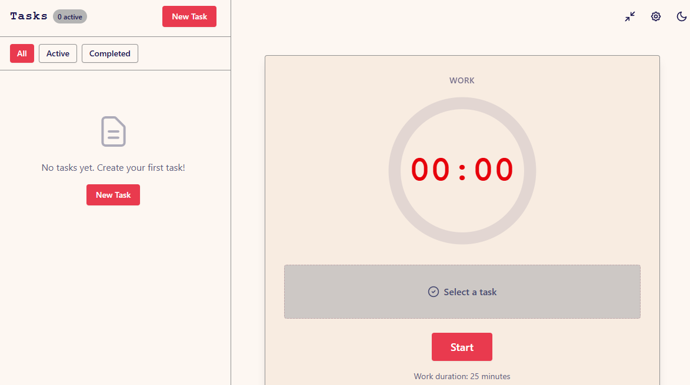
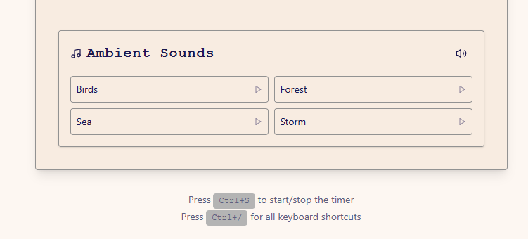
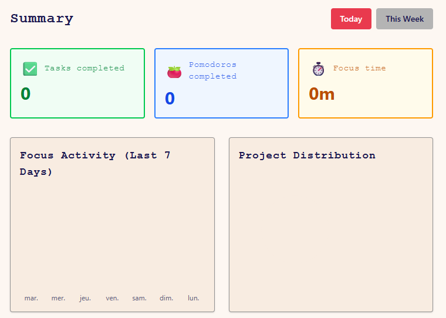
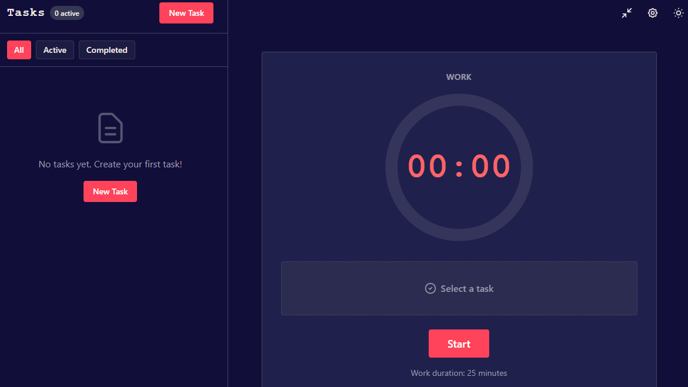

# 🍅 TomatoTask

> **Local-first Pomodoro timer and task manager to stay focused and productive**

[](https://github.com/Lib-LOCALE/TomatoTask/releases/latest)
[](LICENSE)
[](https://github.com/Lib-LOCALE/TomatoTask/releases/latest)

[📥 Download](https://github.com/Lib-LOCALE/TomatoTask/releases/latest) · [🐛 Report Bug](https://github.com/Lib-LOCALE/TomatoTask/issues)

---

## ✨ Why TomatoTask?

**Simple. Local. Effective.**

- 🔒 **100% local** - Your data stays on your computer
- ⚡ **Fast & lightweight** - Native app, no browser needed
- 🎨 **Modern interface** - Clean "Majolique" design
- 🌍 **Multilingual** - English, French, Spanish, Italian, German
- 🌓 **Dark/Light themes** - Visual comfort day and night

## 📸 Screenshots

<table>
  <tr>
    <td width="50%">
      
      <p align="center"><em>Pomodoro Timer</em></p>
    </td>
    <td width="50%">
      
      <p align="center"><em>Task Management</em></p>
    </td>
  </tr>
  <tr>
    <td width="50%">
      
      <p align="center"><em>Detailed Statistics</em></p>
    </td>
    <td width="50%">
      
      <p align="center"><em>Customization</em></p>
    </td>
  </tr>
</table>

## 🚀 Features

### ⏱️ Pomodoro Timer
- Customizable work sessions, short & long breaks
- Visual progress bar
- Native notifications

### ✅ Task Management
- Quick task and project creation
- Daily planning with drag & drop
- Filters and search
- Completion tracking

### 📊 Insights & Statistics
- Daily and weekly productivity
- Progress charts
- Focus Mode for deep work
- Data export for backup

### 🎨 Personalization
- Configurable session durations
- Light/Dark theme
- 5 languages available
- Keyboard shortcuts

## 📥 Installation

### Windows
1. [Download the latest release](https://github.com/Lib-LOCALE/TomatoTask/releases/latest)
2. Run the `.exe` installer
3. You're ready! 🎉

### Linux
```bash
# Download the .AppImage file
chmod +x TomatoTask_*_amd64.AppImage
./TomatoTask_*_amd64.AppImage
```

## 💡 Quick Start

1. **Launch TomatoTask**
2. **Create a task** - Click "+" to add what you need to do
3. **Start a session** - 25 minutes of pure focus
4. **Take a break** - 5 minutes to recharge
5. **Check your stats** - Track your productivity

## 🛠️ Development

**Tech stack:** Svelte 5 + TypeScript + Tauri + Rust + SQLite

```bash
# Install dependencies
npm install

# Run in development mode
npm run tauri dev

# Build for production
npm run tauri build
```

## 📝 What's New in v1.1.0

- 🎨 "Majolique" UI Refresh - Modernized interface
- 🎯 Focus Mode - Distraction-free work
- 📅 Daily Planning - Organize your day
- 📊 Enhanced Insights - Better charts
- ✅ E2E Tests - More reliability

[See full CHANGELOG](CHANGELOG.md)

## 🤝 Contributing

Contributions are welcome! See [CONTRIBUTING.md](CONTRIBUTING.md).

## 📄 License

MIT License - see [LICENSE](LICENSE) for details.

---

<p align="center">
  Made with ❤️ for productivity
</p>
