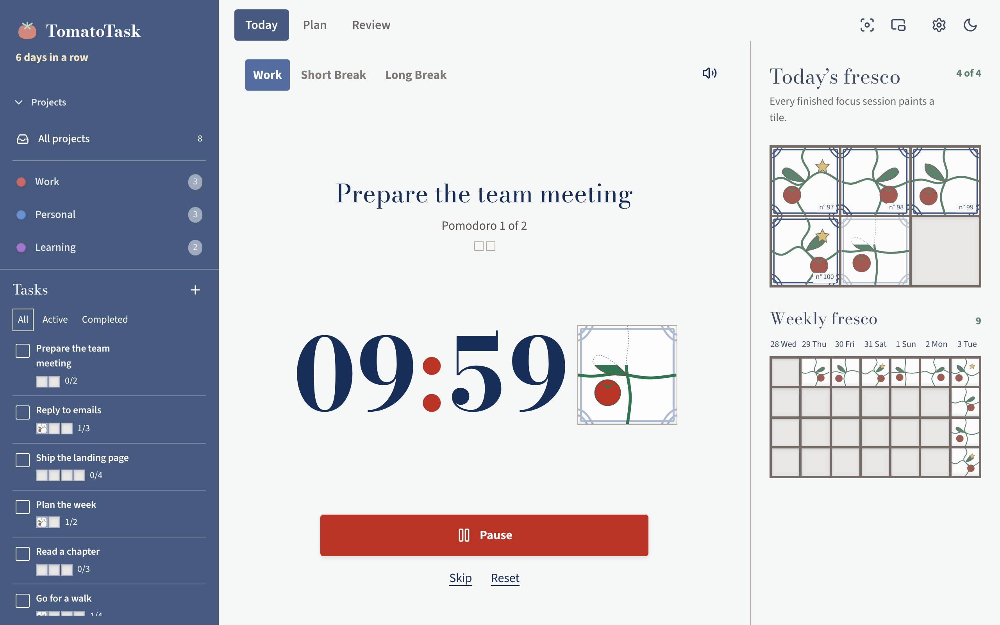
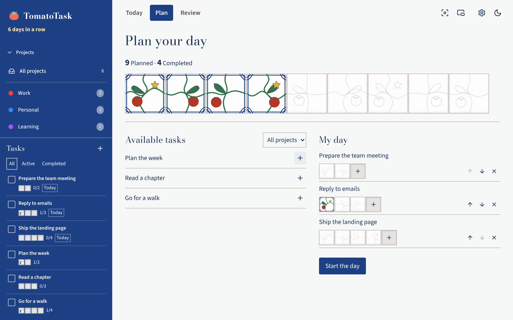
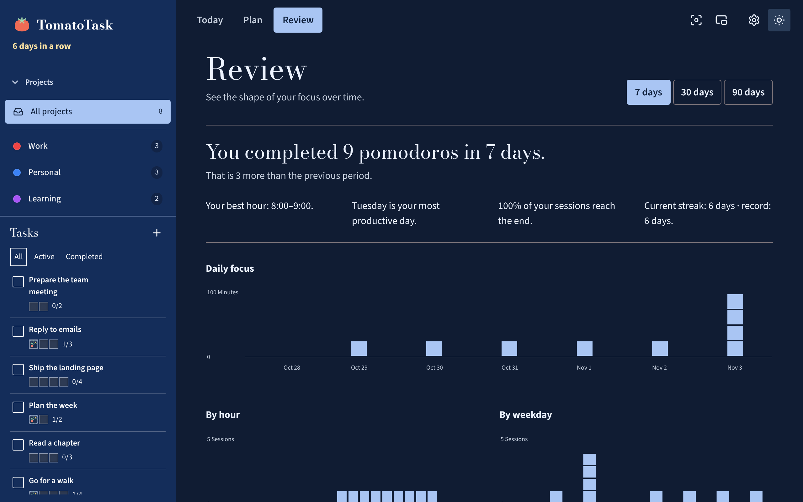
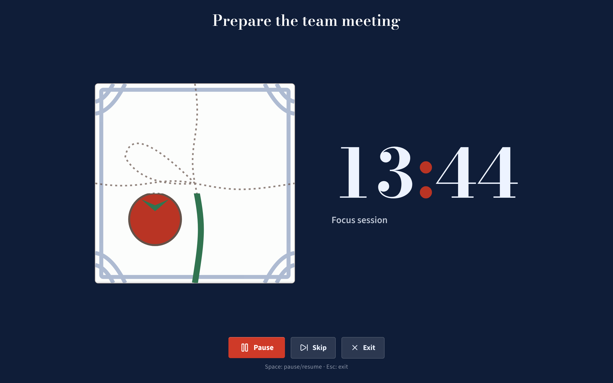

<div align="center">

# 🍅 TomatoTask

**A calm, local-first Pomodoro timer where every focus session paints a tile.**

[](https://github.com/Lib-LOCALE/TomatoTask/releases/latest)
[](https://github.com/Lib-LOCALE/TomatoTask/releases/latest)
[](LICENSE)

[**Download**](https://github.com/Lib-LOCALE/TomatoTask/releases/latest) · [Report a bug](https://github.com/Lib-LOCALE/TomatoTask/issues)



</div>

## Why TomatoTask?

- **Your data stays yours.** Everything is stored locally in SQLite. No account, no cloud.
- **Native and light.** Built with Tauri and Rust, not a bundled browser.
- **Progress you can see.** Each completed pomodoro adds a hand-drawn majolica tile to your daily and weekly fresco.
- **Five languages.** English, French, Spanish, Italian and German, plus light and dark themes.

## A quick tour

<table>
  <tr>
    <td width="50%"><p align="center"><b>Plan</b>: pick today's tasks and see the tiles to fill.</p></td>
    <td width="50%"><p align="center"><b>Review</b>: your focus over 7, 30 or 90 days.</p></td>
  </tr>
  <tr>
    <td width="50%"><p align="center"><b>Focus mode</b>: just the task and the clock.</p></td>
    <td width="50%"><p align="center"><b>Settings</b>: durations, ambient sounds, themes.</p></td>
  </tr>
</table>

## Features

- Work, short-break and long-break timers with 25/5/15 and 50/10/30 presets
- Tasks and color-coded projects with pomodoro estimates
- Daily planning and a full-screen focus mode
- Streaks, best hours and best weekdays
- Ambient sounds (birds, forest, sea, storm) and native notifications
- Keyboard shortcuts (`Ctrl+N` for a new task, `Space` to pause)
- Data export for backups

## Install

**Windows:** download the `.exe` installer from the [latest release](https://github.com/Lib-LOCALE/TomatoTask/releases/latest) and run it.

**Linux:** use the `.deb` package or the AppImage:

```bash
chmod +x TomatoTask_*_amd64.AppImage
./TomatoTask_*_amd64.AppImage
```

## Build from source

Requires Node.js 22+ and Rust (stable).

```bash
npm install
npm run tauri dev     # run in development
npm run tauri build   # build installers
```

Stack: Svelte 5, TypeScript, Tauri 2, Rust, SQLite.

## License

MIT. See [LICENSE](LICENSE). Contributions are welcome, see [CONTRIBUTING.md](CONTRIBUTING.md).
