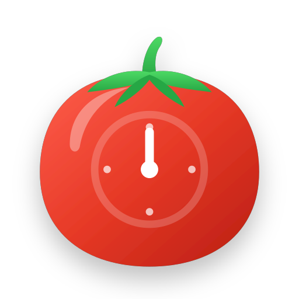
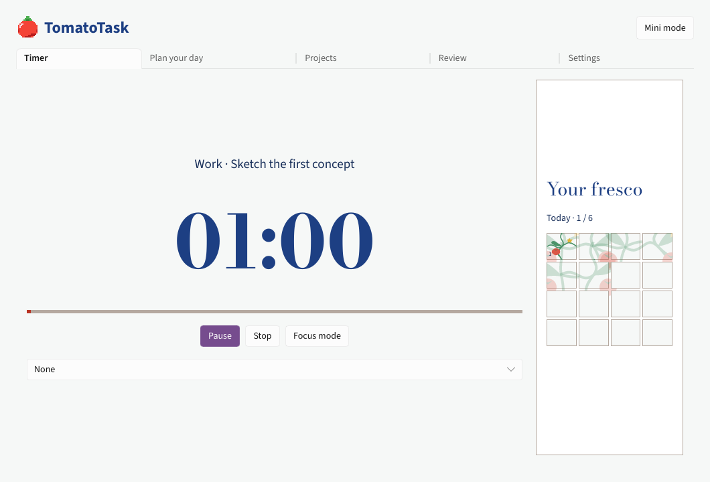

<p align="center"></p>
<h1 align="center">TomatoTask</h1>

<p align="center">A local-first Pomodoro timer and task planner for Linux and Windows.<br>Written in Rust, built with Slint, with data stored in SQLite.</p>

<p align="center">
  <a href="https://github.com/Lib-LOCALE/TomatoTask/actions/workflows/ci.yml"></a>
  <a href="LICENSE"></a>
  <a href="https://github.com/Lib-LOCALE/TomatoTask/releases"></a>
</p>



## What you can do

- Run configurable **work, short break and long break** sessions, with automatic transitions and 25/5/15 or 50/10/30 presets.
- Organise tasks into colour-coded projects, estimate work in pomodoros and plan the day. Unfinished tasks carry over into today's plan.
- Paint a **majolica tile** for each completed focus session. Review daily focus, streaks, productive hours and top tasks across 7, 30 or 90 days.
- Use fullscreen focus mode or a compact timer, with optional ambient sounds and session-end alerts.
- Choose light, dark or system appearance. Use the app in English, French, German, Spanish or Italian.

## Install

The Slint port is **1.2.0 in development**. Build it from source below. The [Releases page](https://github.com/Lib-LOCALE/TomatoTask/releases) lists the published builds, including 1.1.3 for Windows and Linux.

Tagged native builds are configured to produce a Linux x86-64 tar archive and a Windows x86-64 ZIP. Extract the archive and run `tomatotask` on Linux or `tomatotask.exe` on Windows.

## Build from source

Use Rust **1.92 or newer** and a C/C++ build toolchain. On Windows, use the MSVC toolchain with the Visual Studio C++ build tools. On Debian or Ubuntu, install the Linux audio and windowing development libraries.

```sh
git clone https://github.com/Lib-LOCALE/TomatoTask.git
cd TomatoTask
# Debian / Ubuntu
sudo apt install build-essential pkg-config libasound2-dev libfontconfig1-dev \
  libxkbcommon-dev libwayland-dev libegl-dev
cargo run --locked
```

For an optimised executable, use `cargo build --release --locked`. On Linux, you can select software rendering with `SLINT_BACKEND=winit-software cargo run --locked`. The Linux file picker uses the desktop's XDG portal. On Wayland, the compositor controls compact-window sizing and stacking.

## Everyday shortcuts

| Action | Shortcut |
| --- | --- |
| Start, pause or resume | Ctrl+S or Space in the timer view |
| Open the new task form | Ctrl+N |
| Open language and appearance settings | Ctrl+L |
| Leave fullscreen focus mode | Esc |
| Show keyboard shortcuts | Ctrl+/ |

## Local data

The app opens the same SQLite database as 1.1.x, including tasks, projects, session history and settings.

| Platform | Database |
| --- | --- |
| Linux | `$XDG_DATA_HOME/com.tomatotask.app/tomatotask.db` (defaults to `~/.local/share/…`) |
| Windows | `%APPDATA%\com.tomatotask.app\tomatotask.db` |

Export or restore a JSON backup from Settings. Restoring a backup replaces the current data after confirmation.

## Project status

The first-run guide introduces the majolica tiles and daily plan. You can create a first task or skip the guide. The app uses move buttons to reorder tasks and projects. The notification-area menu can open the window and control the timer on Windows and Linux desktops with StatusNotifierItem support.

## Development

```sh
cargo test --locked
cargo fmt --all -- --check
cargo clippy --locked --all-targets -- -D warnings
```

See [CONTRIBUTING.md](CONTRIBUTING.md) for the project layout and [Issues](https://github.com/Lib-LOCALE/TomatoTask/issues) for bug reports.

## Credits and licences

- **Application code and majolica artwork** under the [MIT licence](LICENSE).
- **Slint** under the [Royalty-free Desktop, Mobile, and Web Applications License 2.0](https://github.com/slint-ui/slint/blob/v1.18.1/LICENSES/LicenseRef-Slint-Royalty-free-2.0.md). Settings includes `AboutSlint`.
- **Fonts** under the SIL Open Font License. See [Bodoni Moda](assets/fonts/BodoniModa-OFL.txt) and [Source Sans 3](assets/fonts/SourceSans3-OFL.txt).

<p align="center">
  <a href="https://slint.dev">
    <picture>
      <source media="(prefers-color-scheme: dark)" srcset="https://raw.githubusercontent.com/slint-ui/slint/v1.18.1/internal/compiler/widgets/common/MadeWithSlint-logo-dark.svg">
      
    </picture>
  </a>
</p>
